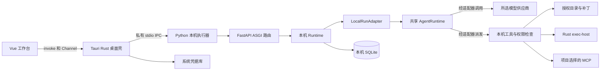
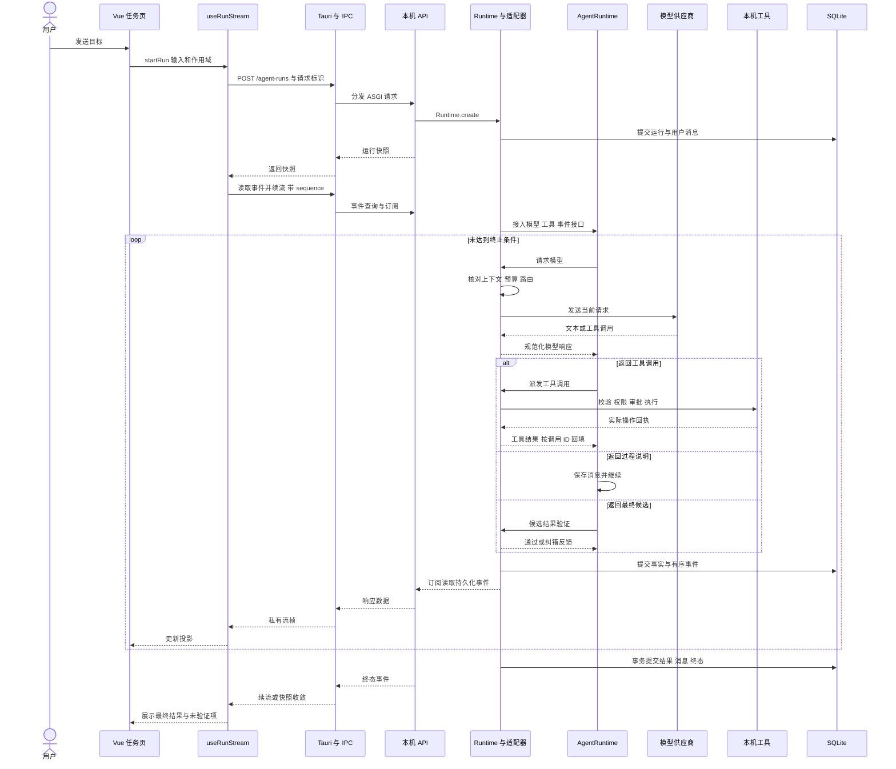
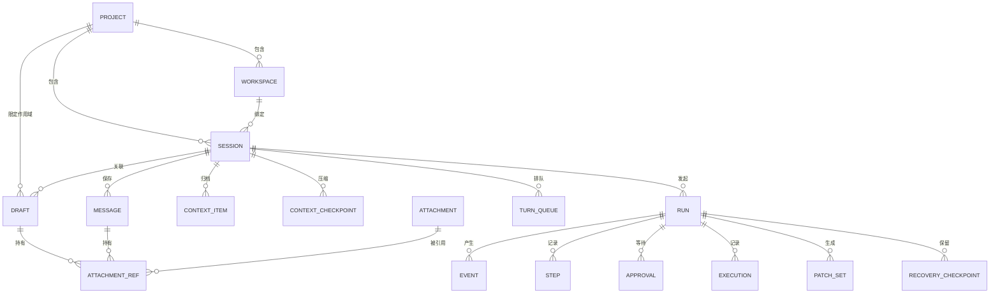
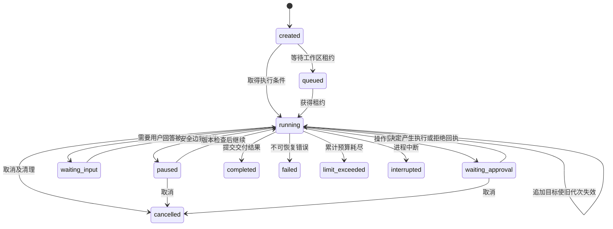
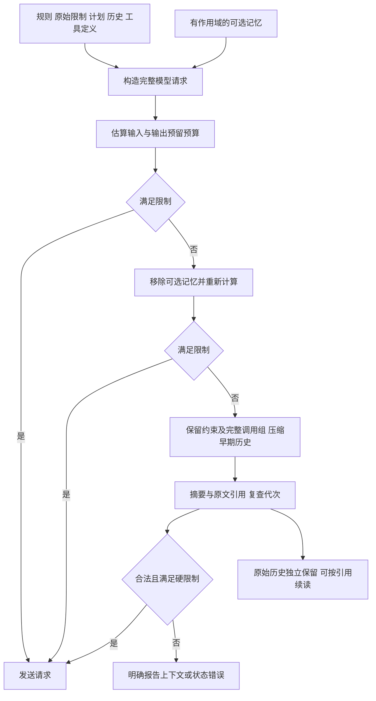

# PrivateAgent 架构与任务调用链

PrivateAgent 将模型决策、运行推进、本机执行和界面展示分成不同职责。理解这些边界后，再阅读工具、上下文和恢复细节，能更快定位每段代码在解决什么问题。

## 进程与依赖



图中的“经适配器”表示调用职责，模型和工具实际由 `LocalRunAdapter` 对接本机服务。共享核心并不直接管理 SQLite、项目路径或桌面组件。

桌面主链通过私有 stdio 复用 ASGI 路由，不要求监听 TCP 端口。执行器入口仍保留显式 `--port` 的旧回环兼容方式，两种启动模式互斥。看见 FastAPI 路由或 SSE 格式，不应推断桌面主链使用公开 HTTP 服务。

| 层 | 实现入口 | 核心职责 |
| --- | --- | --- |
| 交互 | [CodingThreadWorkspace](../../apps/desktop/src/features/coding/components/CodingThreadWorkspace.vue)、[useRunStream](../../apps/desktop/src/features/coding/composables/useRunStream.ts) | 提交、展示、重连和组件清理 |
| 原生边界 | [local_executor](../../apps/desktop/src-tauri/src/local_executor.rs)、[credentials](../../apps/desktop/src-tauri/src/credentials.rs) | 子进程、私有传输、凭据和退出 |
| 请求分发 | [entry](../../src/private_agent_local/entry.py)、[ipc](../../src/private_agent_local/ipc.py)、[create_app](../../src/private_agent_local/app.py) | 将 IPC 请求变成 ASGI 请求，校验边界并分发 |
| 本机编排 | [Runtime](../../src/private_agent_local/runtime.py)、[LocalRunAdapter](../../src/private_agent_local/core_adapter.py) | 会话、上下文、工具、事件和最终持久化 |
| Agent 循环 | [AgentRuntime](../../src/private_agent_core/runtime.py) | 调用模型、派发工具、回填结果、预算和取消 |
| 平台执行 | [ExecutionSessions](../../src/private_agent_local/execution_sessions.py)、[exec-host](../../apps/exec-host/src/main.rs) | 持续进程、输出、stdin、沙箱和进程树清理 |

## 桌面如何启动

从 [backendStartup](../../apps/desktop/src/services/backendStartup.ts) 和 [localExecutor](../../apps/desktop/src/services/localExecutor.ts) 开始：

1. 前端调用 Tauri 的启动命令，合并并发启动请求，检查执行器连接和就绪状态。
2. Rust 选择源码运行或打包执行器，创建私有管道，管理待响应请求；退出时清理所属进程和请求。
3. Python `entry.main` 加载受控启动参数并创建本机应用。启动凭据环境变量在执行用户命令前移除。
4. 前端调用 `POST /identity/local` 建立本机身份，随后同步当前项目上下文。
5. 本机身份决定数据空间。该绑定流程承担本机会话识别职责，无需平台账号登录。

供应商的 401 与标记为本机会话过期的 401 分别处理。重新建立连接不会自动重放失败的写请求。

## 一次任务如何运行



源码阅读顺序：

1. [任务页的 send](../../apps/desktop/src/features/coding/components/CodingThreadWorkspace.vue#L593)整理项目、工作区、会话、权限、模型和材料。已有任务页直接调用 `useRunStream.startRun`；工作台 store 提供选择状态和任务入口。
2. [useRunStream.startRun](../../apps/desktop/src/features/coding/composables/useRunStream.ts#L270)维持请求标识。创建响应丢失时按请求标识核对已有运行，同时比较正文和附件。
3. [create_run](../../src/private_agent_local/app.py#L787)核对模型恢复、作用域模型偏好、视觉附件及执行协议，再调用 `Runtime.create`。
4. [Runtime.create](../../src/private_agent_local/runtime.py#L225)核对绑定、目录、重复请求、活动任务、权限和任务解释，提交用户消息及运行后再推进执行。
5. [Runtime._execute](../../src/private_agent_local/runtime.py#L390)记录工作区基线，构造 `LocalRunAdapter` 和 `LocalCompletionVerifier`，接入共享运行时。
6. [AgentRuntime._drive](../../src/private_agent_core/runtime.py#L775)调用模型。阶段说明可以继续循环；工具结果回填后继续；最终候选需要经过验证器。
7. [LocalContext.prepare](../../src/private_agent_local/context_manager.py#L135)在每次模型请求前重新核对路由、权限、规则、上下文与预算。
8. [LocalRunAdapter._execute](../../src/private_agent_local/core_adapter.py#L318)核对代次并交给 `Runtime.tool`。具体文件、命令和 MCP 各有自己的执行边界。
9. 最终输出、验收结果和助手消息在本机事务中提交。持久化失败会重新读取已提交状态，避免保存内存中的虚假成功。

## 核心实体

以下是逻辑关系。主库部分实体使用共享 ID 与 JSON 业务字段保存，并非图中每条线都对应数据库外键。



| 名称 | 含义 | 阅读时检查 |
| --- | --- | --- |
| project | 用户登记并授权的项目 | 状态、授权和根目录 |
| workspace | 实际执行目录，可为项目根或 worktree | 路径身份与项目绑定 |
| session | 一条持续对话，前端也称 thread | 所属项目、工作区和最近运行 |
| run | 一次目标的执行记录 | 请求标识、状态、代次、预算、验收结果 |
| event | 带单调序号的运行事件 | 去重、续读、事务一致性 |
| execution | 一次工具操作的记录 | 参数、输出、审批和副作用是否已确认 |
| context item | 给模型使用的原始消息与工具结果 | 来源、摘要、配对和原文引用 |
| checkpoint | 压缩或恢复检查点 | 区分上下文压缩与任务恢复 |

当前主库 `SCHEMA_VERSION = 10`。长期记忆使用同身份目录中的独立 `memories.sqlite3`，凭据由系统凭据库管理，附件正文另存并以 SHA-256 核对。相关实现见 [Store](../../src/private_agent_local/store.py)、[MemoryStore](../../src/private_agent_local/memory_store.py)和[附件模块](../../src/private_agent_local/attachments.py)。

## 三组必须区分的状态

### 界面连接与后台运行

组件卸载或断线会关闭当前流和定时器。后台运行是否取消，由取消 API 和执行器控制。重新连接通过快照、缺失事件及流续读收敛，不等于重跑任务。

### 运行状态与目标结果

本机运行的 `created`、`queued`、`running`、`waiting_approval`、`waiting_input`、`paused`、`interrupted`、`completed`、`failed`、`cancelled`、`limit_exceeded` 描述执行生命周期。共享核心还区分 `timed_out`，本机交付会映射相应的预算终止状态。

完成契约中的 `goal_outcome` 描述目标是否 `answered`、`verified`、`unmet`、`blocked` 或 `unknown`。结束的运行可以如实报告受阻或未确认，面试时要结合两层判断。定义见[完成契约](../../src/private_agent_core/completion.py)和[本机验证器](../../src/private_agent_local/completion.py)。

### 请求序号与版本

| 标识 | 作用 |
| --- | --- |
| `client_request_id` | 核对重复提交；不能把同一标识用于不同正文或材料 |
| 事件 `sequence` | 当前运行事件的续读与幂等消费 |
| 前端 `generation` | 拒绝切换任务或卸载后迟到的回调 |
| 后端 `generation` | 使追加要求前的模型响应或工具调用失效 |
| `goal_version` | 当前目标版本，提醒计划重新核对 |
| `expected_plan_version` | 计划更新的乐观并发检查 |
| `expected_state_version` | 暂停、继续等控制请求的状态检查 |
| 文件版本与 `preview_sha256` | 绑定读取事实、补丁预览和执行 |
| 模型配置及能力指纹 | 阻止不兼容的运行续接或恢复 |

### 控制状态图

图中只列主要路径，实际转换还会核对状态版本、请求身份和安全边界。



`completed` 仍需结合目标结果判断。取消或中断后创建关联恢复运行时，原运行保留终态；这与暂停后沿用同一 run 的继续不同。审批、暂停与取消竞争的细节见[RunControls](../../src/private_agent_local/run_controls.py)和[恢复测试](../../tests/unit/test_local_recovery.py)。

## 上下文装配与压缩



这是预算决策示意。实际装配还检查模型路由、原生状态、规则来源和压缩是否过期；token 估算与供应商协议存在差异。原文保留不表示本次请求仍包含全部旧内容。源码见[LocalContext](../../src/private_agent_local/context_manager.py)、[ContextHistory](../../src/private_agent_local/context_history.py)与[上下文测试](../../tests/unit/test_local_compaction.py)。

## Agent 循环伪代码

下面用于解释控制流，细节以 `AgentRuntime` 为准。

```python
async def explain_agent_loop(messages, tools, budget, cancellation):
    while True:
        # 每轮复查取消与预算，纠错继续使用累计预算。
        check_limits(budget, cancellation)
        response = await call_model(messages, tools)
        require_complete_response(response)
        record_response_and_usage(response)

        if response.phase == "commentary" and not response.tool_calls:
            messages.append(response.as_message())
            continue

        if response.tool_calls:
            validate_batch_budget(response.tool_calls, budget)
            messages.append(response.as_message())
            for result in await dispatch_allowed_calls(response.tool_calls):
                # 结果按调用顺序记录；实际权限由本机执行层判断。
                messages.append(tool_result_message(result))
            continue

        verification = await verify_candidate(response.text)
        if verification.passed:
            return response.text
        if not verification.retryable or retries_exhausted():
            raise OutputValidationFailed(verification)
        messages.extend([response.as_message(), correction_message(verification)])
```

工具失败通常作为工具结果返回模型，协议错误、事件持久化失败、取消或预算耗尽则有各自终止方式。实际实现最多并行两个符合条件的相邻只读调用，涉及副作用的操作保留执行顺序。

## 第一次阅读的自测

用“读取一个文件、提出补丁、请求批准、执行测试”举例，分别定位创建记录、发起模型请求、校验文件版本、等待审批、持久化执行事实和提交最终答案的位置。

再回答：如果审批期间用户修改文件，谁发现变化？如果前端断线，谁继续运行？如果命令已发送而结果丢失，恢复机制为什么不能直接重发？这些问题对应[模块卡](modules.md)与[实验手册](labs.md)。
